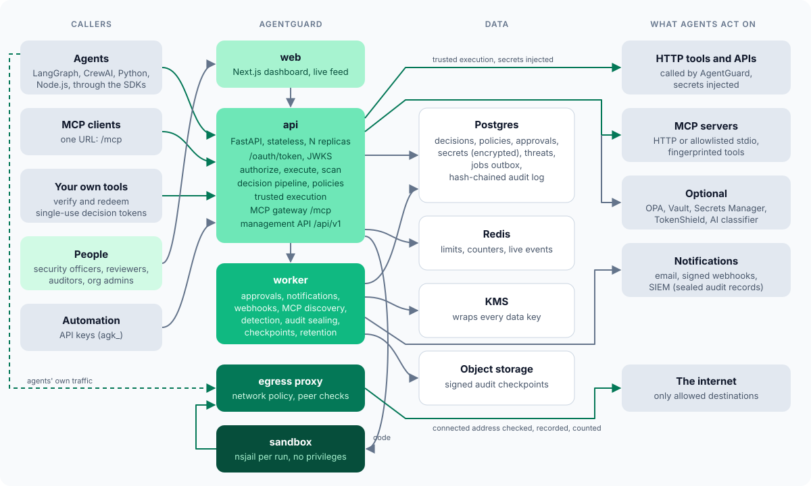
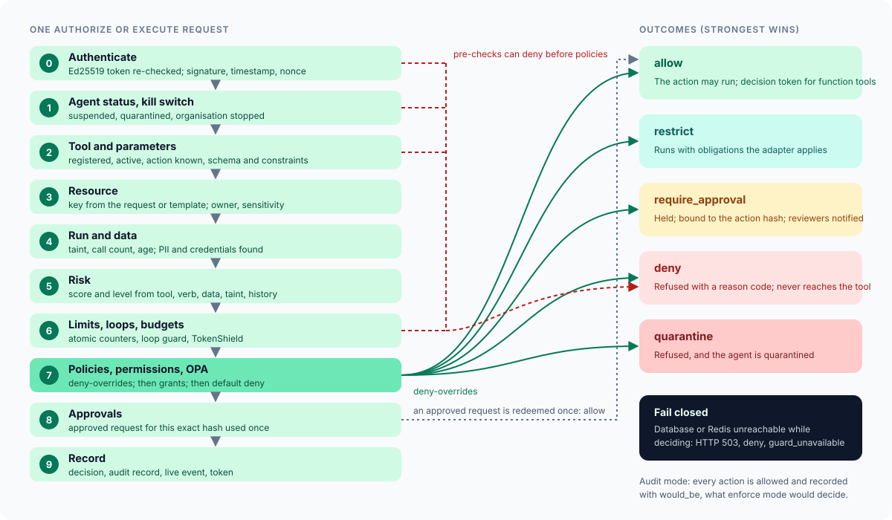
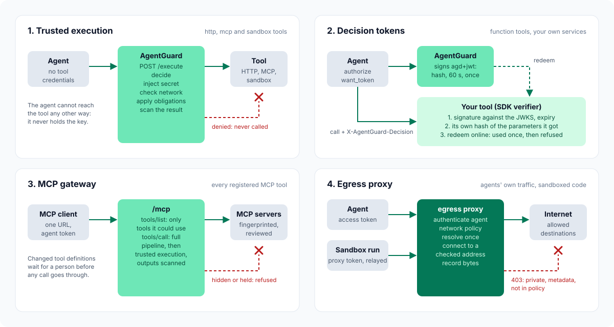

# High-level design

Euron Open AgentGuard is a self-hosted security layer between AI agents and the resources
they act on. Every agent has its own identity. Every action (a tool call, an MCP call, an
outbound connection, a piece of code to run) is decided by deterministic policy before it
happens, and the decision, its reason and the policy version that made it are recorded in
a tamper-evident log. Sensitive actions wait for a person, bound to the exact parameters
that person saw. Credentials stay inside AgentGuard and are injected at execution time.
Untrusted code runs in an unprivileged sandbox, outbound traffic goes through an egress
guard, and an agent that behaves suspiciously is quarantined, its credentials revoked and
an incident opened, automatically if the organisation wants.

## Goals and non-goals

| Goals (0.1.0) | Non-goals (0.1.0) |
| --- | --- |
| A denied action never reaches the resource when it goes through an enforcement point (trusted execution, decision-token verification, the MCP gateway, the egress proxy) | Guarding model calls inside the agent (TokenShield governs model spend; AgentGuard governs actions) |
| Decisions are deterministic, explainable (rule, version, reason code) and replayable in simulation | ReBAC relationship graphs, access review campaigns |
| An approval is bound to the exact action and re-checked when the action runs | Slack and Teams approval buttons (email and signed webhooks only) |
| Credentials never leave AgentGuard; agents and sandboxed code never see them | mTLS or SPIFFE workload identity |
| Fail closed: when AgentGuard cannot decide, the action is denied | Firecracker, gVisor or Kubernetes sandboxes (the adapter interface ships, nsjail is the implementation) |
| Works with any framework and needs no other Euron product | A hosted SaaS (it is multi-organisation, but you operate it) |

## Context

| Actor | Talks to | How |
| --- | --- | --- |
| An agent (LangGraph, CrewAI, plain Python or Node.js, an MCP client) | `api` | `POST /oauth/token` for a token, then `/api/v1/authorize`, `/api/v1/execute`, `/api/v1/content/scan`, `/api/v1/approvals` (ask a person), `/mcp`; through the SDKs or plain HTTP |
| An agent's outbound traffic, sandboxed code | `egress` | HTTP forward proxy with `Proxy-Authorization` (agent token, or the sandbox's proxy token) |
| A tool the organisation runs itself (a FastAPI route, an Express handler, a Python function) | `api` | Verifies a decision token against `/.well-known/jwks.json`, then redeems it with `POST /api/v1/decisions/redeem` (management API key) |
| Security officers, reviewers, auditors, org admins | `web` | Cookie session, REST under `/api/v1`, WebSocket `/ws/dashboard` |
| Automation (CI, infrastructure as code) | `api` | Management API keys `agk_...` with read or write scope; they never authorize agent actions |
| Identity provider | `api` | OpenID Connect authorization code flow with PKCE |
| Receivers of events | Webhook endpoints, a SIEM | Signed webhooks (`X-AgentGuard-Signature`), NDJSON forwarding of sealed audit records |
| Optional external systems | `api`, `worker` | OPA (Rego), TokenShield (budgets), HashiCorp Vault and AWS Secrets Manager (secret stores), an AI classifier (OpenAI-compatible, Ollama or Anthropic) |

## Containers

| Container | Port (local) | What it does | Where |
| --- | --- | --- | --- |
| `web` | 5110 | Next.js 15 dashboard: the 16 pages, sign-in, onboarding and the live decision feed. Rewrites `/api` to the API on the Compose network | `apps/web/` |
| `api` | 5130 | FastAPI. Management API `/api/v1`, `/oauth/token`, `/.well-known/jwks.json`, the decision API, the MCP gateway `/mcp`, the WebSocket feed. Stateless | `apps/api/src/agentguard/`, `agentguard serve` |
| `worker` | none (metrics on 9464) | Jobs from the Postgres outbox (approval notifications, approval execution and expiry, threat emails, webhook deliveries) and periodic tasks (audit sealing and checkpoints, MCP health and discovery, behavioural and exfiltration detection, retention, expiring secrets, SIEM forwarding). Stateless | `agentguard worker`, `background.py`, `core/jobs.py`, `core/tasks.py` |
| `egress` | 5128 (3128 inside) | Forward proxy enforcing network policy for agents and the sandbox | `agentguard egress`, `network/proxy.py` |
| `sandbox` | 5135 through `sandbox-gateway` | Unprivileged nsjail runner for Python, Node.js and shell on the internal `sandbox` network | `apps/api/src/agentguard_sandbox/`, [sandbox.md](sandbox.md) |
| `mockai` | 5150 | Test and demo fixture: mock classifier model, mock OIDC provider, mock TokenShield, demo HTTP tools and demo MCP servers. Never deployed to AWS | `apps/api/src/mockai/` |
| `postgres` | 5142 | Everything durable (Postgres 16) | RDS on AWS |
| `redis` | 5179 | Counters, rate limits, the policy generation, live event fan-out. Optional for one replica | ElastiCache on AWS |
| `floci` | 5166 | Local AWS: KMS, S3, Secrets Manager, SES, provisioned by the same Terraform modules | real AWS |
| `opa` | 5181 | Optional OPA sidecar for organisations that write Rego | your OPA |
| `vault` | 5182 | Optional HashiCorp Vault (dev mode) for the Vault secret store | your Vault |
| `mailpit` | 5125 | Every email the stack sends, locally | SES on AWS |

One Python source tree builds two images: `server` (api, worker, egress, CLI, mockai) and
`sandbox`. The web app has its own image.

## The decision pipeline

`decisions/pipeline.py`, one function, `authorize()`, called by `/api/v1/authorize`,
`/api/v1/execute`, the MCP gateway's `tools/call`, the approval execution job and the
"ask a person" endpoint. Each step can only add caution. A step that decides (a deny
before policies) skips policy evaluation, but the decision is still recorded and audited.

0. **Authenticate** (before the pipeline, `identity/dependencies.py`): the bearer token is
   an Ed25519 agent token; its agent, credential and token version are re-read. If the
   agent requires signed requests, or sends a signature anyway, the HMAC, the timestamp
   window and the nonce are checked and the nonce is stored (replays refused).
1. **Agent status and kill switch**: a suspended or quarantined agent gets `deny`
   (`agent_suspended`, `agent_quarantined`); so does every agent of an organisation whose
   kill switch is on (`kill_switch`).
2. **Tool**: registered (in enforce mode, or with `require_registered_tools`), not disabled,
   not `pending_review`, the action supported, the parameters valid against the tool's
   JSON schema and constraints (`invalid_parameters`, with every problem listed).
3. **Resource**: the key from the request or the tool's `resource_template`, looked up in
   the resource registry for its project, sensitivity, environment and data classes.
4. **Run and data**: the run is upserted (calls counted, age, taint read); the parameters
   are scanned for personal data and credentials; open threats and recent denies of the
   agent are read; the agent's roles and permissions are resolved.
5. **Risk**: a score from the tool's baseline, the verb, the resource, the data classes,
   external destinations, taint, the agent's history and the organisation's risk rules.
6. **Limits, loops, budgets**: limits by scope and metric (atomic), the loop guard
   (identical actions in five minutes), the burst detector, TokenShield budgets when
   connected.
7. **Policies**: every active policy, deny-overrides, specificity explains ties; then
   permissions; then the default (deny in enforce mode). Then OPA when connected, combined
   deny-overrides.
8. **Approvals**: for `require_approval`, an approved request for this exact action hash is
   consumed once (the action becomes `allow`, reason `approved`); a pending one is returned
   again; a rejected one denies with the reviewer's reason; otherwise a new request is
   created and reviewers are notified.
9. **Record**: the decision row (redacted parameters and evaluation input, the deciding
   policy and version, every matched rule, risk factors, obligations), an audit record, a
   live event, failure counters and the deny-streak detector, a `decision.denied` webhook,
   and a decision token when the tool needs one. A `quarantine` decision quarantines the
   agent in the same transaction.

Everything is written in the caller's transaction and committed once; live events are
published after the commit. In **audit mode** every action is allowed and the decision
records `would_be`, what enforce mode would have done.

## Enforcement points

| Point | Tools | How a denied action is stopped |
| --- | --- | --- |
| Trusted execution, `POST /api/v1/execute` | `http`, `mcp`, `sandbox` | AgentGuard runs the action itself after deciding; the agent never holds the tool's credentials, so there is no other path. Network policy and peer checks on HTTP tools, obligations applied, results scanned |
| Decision tokens | `function` (in-process or the organisation's own service) | The tool verifies a single-use Ed25519 token bound to the action hash, then redeems it online; without a valid unused token for exactly these parameters it refuses |
| MCP gateway, `/mcp` | every registered MCP tool | Hidden from `tools/list` when the agent can never use it; every `tools/call` goes through the pipeline and trusted execution |
| Egress proxy | an agent's own outbound traffic, sandboxed code with network | Connections outside the agent's network policy are refused with 403 and recorded |

`authorize` alone (the agent checks `allowed` and acts) is advice. It is offered for audit
mode and gradual adoption, and the SDK documentation says so ([ADR-0003](adr/0003-trusted-execution-and-decision-tokens.md)).

## Data stores

| Store | Holds | Notes |
| --- | --- | --- |
| Postgres | Organisations, people, agents, credentials, roles and permissions, resources, tools, MCP servers and tool versions, policies and versions, runs, decisions, decision tokens, approvals, secrets (ciphertext and wrapped data keys), threats, incidents, network policies and egress events, sandbox sessions, limits, integrations, webhooks, jobs, the audit log, request nonces | 49 tables, one Alembic revision ([data-model.md](data-model.md)). Append-only tables are enforced by triggers |
| Redis | Windowed counters (limits, loops, bursts, deny streaks, blocked egress), rate limits, the policy generation per organisation, live event pub/sub | Optional for a single replica. Nothing that would weaken security on eviction lives only here |
| Object storage | Signed audit checkpoints (the audit bucket, Object Lock on AWS), incident and compliance exports, evidence | Local directory or S3 (Floci locally). Rows keep only the key |
| KMS or the local key | Wraps per-secret data keys; seals signing keys, approval parameters, credential signing secrets, OIDC client secrets, integration and webhook secrets, the AI classifier key | `KEY_MODE=kms` on AWS. The encryption context is bound to the record |
| External secret stores | Secret values of stores `aws` (Secrets Manager) and `vault` (Vault KV v2); `env` reads an allowlisted host variable | AgentGuard keeps the reference and version id only |

## Caching layers

Every cache has one owner, a key that includes everything its value depends on, and an
invalidation trigger. A cache that cannot be read is a miss, never a stale answer that
grants something.

| Layer | What | Where | Key | TTL | Invalidation | Proven by |
| --- | --- | --- | --- | --- | --- | --- |
| Active policies | The compiled active version of every active policy of an organisation | Process memory (`policies/service.py`), cleared at 5000 organisations | `org_id`, tagged with the policy generation | none: valid while the generation matches | Every create, version save, activation, rollback, disable and delete bumps `policy-gen:{org_id}` in the KV store in the same request; tool registration, MCP discovery and review, agent registration and integration changes bump it too. When the KV store cannot be read the generation is `-1` and the cache is bypassed | `test_versions_activation_rollback_and_decisions_name_their_version` |
| Agent grants | An agent's roles (with inheritance) and permissions | Process memory (`access/resolve.py`) | `(org_id, agent_id)`, tagged with the policy generation | as above | Same generation counter: role, permission and binding changes bump it | `test_role_inheritance_grants_parent_permissions` |
| Organisation settings | Enforcement mode, kill switch, detection, threat responses, retention, notifications | Process memory (`org/service.py`), cleared at 10 000 organisations | `org_id` | 1 s (`SETTINGS_TTL_S`) | A write on this replica drops the entry at once; other replicas re-read within one second. Retention and the kill switch writer read `fresh=True` | `test_the_kill_switch_stops_everything_within_a_second` |
| Managed secret values for leak scanning | Current values of `database`-store secrets, to find them in tool outputs | Process memory (`decisions/outputs.py`) | `org_id` | 30 s (`SECRET_CACHE_S`) | Creating, rotating, revoking or deleting a secret clears the entry on the replica that did it; others within 30 s | `test_a_tool_echoing_its_credential_is_caught` |
| MCP upstream connections | One long-lived MCP session per server | Process memory (`mcp/upstream.py`, `UpstreamPool`) | `server_id` | idle 300 s, then reaped | A change to the server's URL, command, arguments or secret bindings bumps `config_version`; the next call opens a new session. A failed connection is replaced | `test_one_endpoint_lists_only_what_an_agent_may_use` |
| TokenShield budget state | Whether a watched budget is spent | Process memory (`integrations/tokenshield.py`) | integration id | 10 s (`CACHE_S`) | Saving or testing the integration clears it | `test_tokenshield_budgets_deny_when_spent_and_fail_open_when_down` |
| Signing keys | Public keys (and the active private key) | Process memory (`identity/keys.py`) | `kid` | none | Reloaded when a token names an unknown `kid`; `rotate-keys` reloads on the replica that ran it | `test_decision_tokens_are_bound_single_use_and_verifiable` |
| JWKS in the SDKs | AgentGuard's public keys | SDK process memory | base URL | 300 s (`jwks_ttl_s`) | Refreshed early when a token names an unknown `kid` | SDK tests |
| React Query | Server state in the dashboard | Browser | per-feature keys (`apps/web/src/lib/query-keys.ts`) | `staleTime`: live 5 s, lists 15 s, config 30 s, static 5 min | WebSocket invalidations; mutations invalidate their keys | web unit tests |

Deliberately **not** cached: agent and credential status (read on every request, so
revocation is immediate), request nonces and revoked sessions (Postgres rows, so eviction
cannot revive a replay or a signed-out session), approval state (read with a row lock),
decision token redemption (one conditional `UPDATE`), and the network policy (read per
connection).

## Scaling

| What | How it scales |
| --- | --- |
| API | Stateless. N replicas behind the load balancer. Shared state is in Postgres and Redis; per-process caches are invalidated by the generation counter or expire within a second (settings) |
| Worker | Stateless. N replicas claim jobs with `FOR UPDATE SKIP LOCKED` and leases (`JOB_LEASE_S`, extended by a heartbeat); a dead replica's jobs are reclaimed. Periodic tasks run under a Postgres advisory lock per task, so one replica runs each |
| Audit sealing | One sealer per organisation at a time (advisory lock), so writers on every replica insert without contention |
| Egress | Stateless; N replicas behind a network load balancer. Counters go to Redis |
| Sandbox | Each task runs `SANDBOX_CONCURRENCY` programs; add tasks for more |
| Postgres | Indexes on every filter the API exposes, keyset pagination on decisions and audit records, pool sized by `DB_POOL_SIZE` and `DB_MAX_OVERFLOW` |
| Redis | Small keys, atomic Lua scripts; nothing durable |

Measured throughput and latency (`authorize` p50/p99 25ms/230ms, 116 decisions/s at 50
concurrent agents, the policy engine itself 96 microseconds per decision, audit sealing
7,303 records/s, verification 15,251 records/s): see [Performance](../../README.md#-performance)
and `docs/bench.json`. `make bench` does not separately measure the MCP gateway, the egress
proxy or sandbox start time.

## Failure modes

AgentGuard fails closed. When it cannot decide, the action is denied.

| Failure | What happens |
| --- | --- |
| Postgres unreachable while deciding | `authorize` and `execute` answer 503 with `decision: deny` and `reason_code: guard_unavailable` (`test_agentguard_fails_closed_when_its_database_is_unreachable`). The SDKs treat any error as a denial. Readiness fails |
| Redis configured but unreachable or full | Counting a limit, a loop or a deny streak raises; the request is denied with `guard_unavailable` as above. The policy cache is bypassed (generation `-1`). Live events are not published |
| OPA unreachable or erroring | Sensitive tools are denied (`opa_unavailable`); other tools keep the native decision |
| TokenShield unreachable | `fail_mode: open` (default) ignores budgets and local limits still apply; `fail_mode: closed` denies (`budget_exhausted`) |
| Sandbox unreachable | The `execute` call is allowed but not executed: `execution: error`, `sandbox_unavailable`. Nothing runs anywhere else |
| An HTTP tool or MCP upstream times out or refuses | `execution: error` with `tool_timeout`, `tool_unreachable` or `mcp_upstream_error`; the decision stays recorded |
| A destination outside the network policy, or DNS rebinding | `execution: blocked` (`network_blocked`, `dns_rebinding`) and an egress event |
| A secret expired, revoked, without a lease or for another host | `execution: blocked` (`secret_refused`) and a refusal in the secret access log |
| A worker dies mid-job | Its lease expires and another worker reclaims the job; fenced writes make results appear once |
| An approval expiry job is lost | The `approvals.expire` periodic task expires overdue requests every 60 s |
| The AI classifier fails | No second opinion; the heuristic verdict stands |
| A webhook receiver keeps failing | Retries with backoff; switched off after 10 consecutive failures with the reason |

## Deployment

| Shape | How | Use |
| --- | --- | --- |
| Local, emulated AWS | `make up`: Compose with Floci provisioned by the `local-floci` Terraform (KMS, S3, Secrets Manager, SES) | Development, evaluation, the demo ([quickstart-local.md](../guides/quickstart-local.md)) |
| Local against real AWS | `make up-aws` with `deploy/compose/.env.aws` | Testing KMS, S3 and SES for real ([local-with-aws.md](../guides/local-with-aws.md)) |
| AWS | `make aws-deploy`: ECS Fargate (api, worker, web, egress) behind an ALB, the sandbox on ECS on EC2 with the seccomp profile and no task role, RDS PostgreSQL, ElastiCache, S3 with Object Lock for checkpoints, KMS, Secrets Manager, SES, CloudWatch | Production ([deploy-aws.md](../guides/deploy-aws.md)) |

## Observability

Structured JSON logs with request ids (`X-Request-Id` in and out), one line per decision
(`msg: decision` with the decision, mode, agent, tool, action and reason code), and named
lines for threats, quarantines, blocked egress and failed jobs that the Terraform
`observability` module turns into metrics and alarms ([operations.md](../guides/operations.md)).
Prometheus `/metrics` on the API and the worker; `/healthz` and `/readyz`;
`GET /api/v1/system` shows queue counts and component health; optional OpenTelemetry
hooks (`OTEL_ENABLED`).
