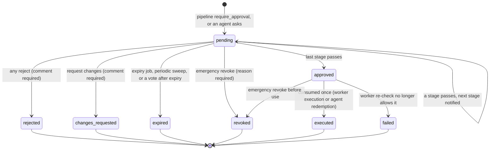

# Low-level design

How the code is organised and how the moving parts behave. Read [HLD.md](HLD.md) first.

## Domain packages

`apps/api/src/agentguard/` is packaged by domain ([ADR-0012](adr/0012-domains-in-one-package-sdks-separate.md)).
A domain owns its `router.py` (HTTP only), its service module (rules and queries) and its
`models.py`. A domain calls another domain's service.

| Package | Owns |
| --- | --- |
| `core` | Settings and the production boot guard (`config.py`), engine and session with the `OrgScoped` mixin (`db.py`), the error envelope (`errors.py`), ASGI middleware: request ids, security headers, body limits (`middleware.py`), the jobs outbox (`jobs.py`), periodic tasks (`tasks.py`), live events (`events.py`, `hub.py`), the KV store (`kv.py`), sealing with KMS or AES-GCM (`sealing.py`), canonical JSON and the action hash (`canonical.py`), URL safety (`net.py`), storage, mail, password and key hashing (`security.py`) |
| `auth` | Sign-up, sign-in with lockout, sessions and revocation, CSRF, invitations, OIDC, role and API-key dependencies |
| `users` | People and their dashboard roles |
| `org` | Organisations, projects, settings documents (enforcement, kill switch, detection, threat responses, retention, notifications) and their 1 s cache |
| `identity` | Agents, credentials, the token exchange, signed requests, status changes, the Ed25519 key ring (`keys.py`) |
| `access` | Agent roles with inheritance, permissions, role bindings, the resource registry, grant resolution (`resolve.py`) |
| `tools` | The tool registry, parameter validation and resource templates (`validation.py`) |
| `policies` | The YAML format (`dsl.py`), the expression language (`expr.py`), the engine (`engine.py`), built-in policies (`builtin.py`), versions, activation, simulation (`service.py`) |
| `decisions` | The pipeline (`pipeline.py`), entry points (`service.py`), trusted execution (`execute.py`), output processing (`outputs.py`), dry runs (`preview.py`), runs, decisions and decision tokens |
| `approvals` | Requests, votes, stages, history, consumption, expiry |
| `secrets` | Stores, envelope encryption, versions, rotation, leases, the access log, `resolve_for_use` |
| `protection` | Data detectors and redaction (`detectors.py`), the prompt injection guard and spotlighting (`injection.py`) |
| `threats` | Threat events, deduplication, automatic responses, the AI classifier (`classifier.py`), behavioural baselines |
| `risk` | Risk scoring (`engine.py`) and organisation risk rules |
| `limits` | Usage limits and their counters |
| `network` | Network policies and their evaluation (`service.py`), the egress proxy (`proxy.py`), proxy credentials (`egress_auth.py`) |
| `sandbox` | The client of the sandbox service and sandbox session records |
| `mcp` | The server catalog, discovery and review (`catalog.py`), the upstream pool (`upstream.py`), the `/mcp` gateway (`gateway.py`) |
| `audit` | The audit log, sealing, verification, checkpoints, retention of details |
| `incidents` | Incidents, timelines, evidence, containment, exports |
| `compliance` | The OWASP ASI01 to ASI10 report |
| `integrations` | API keys, webhooks and deliveries, OPA, TokenShield, SIEM |
| `realtime` | The dashboard WebSocket |
| `system` | Health, readiness, metrics, deployment info |
| `demo` | The Kestrel Labs seed |
| `background.py` | Worker job handlers and periodic tasks that span domains |

Tenant-owned tables carry `org_id` through `OrgScoped`; lookups by primary key compare
`row.org_id` with the caller's organisation and answer 404 on a mismatch.

## The action hash

`core/canonical.py`. Approvals and decision tokens are bound to it, and the SDKs compute
the same value from `sdks/testdata/action-hash-vectors.json`.

```
action_hash = sha256(b"agentguard-action-v1\x00" + canonical_json({
    "org": org_id, "agent": agent_id, "tool": tool, "action": action,
    "resource": resource, "params": parameters }))
```

`canonical_json` normalises recursively (depth at most 64): strings and keys to Unicode
NFC, integral floats below 2^53 to integers (`5.0` and `5` are the same amount), NaN and
infinity refused, unsupported types refused; then `orjson` with sorted keys and no
whitespace. The organisation and agent are inside the hash, so the same parameters for a
different agent are a different action.

## Policy compilation and evaluation

`policies/dsl.py` turns YAML into a compiled dictionary stored with the version:

1. `yaml.safe_load`, at most 200 KB; the document must be a mapping.
2. Pydantic models with `extra="forbid"` for the policy, its scope, rules, approvals and
   obligations: unknown keys are errors with their location.
3. The rule map form (`rules: {read: {...}}`) becomes a list, one rule per action.
4. Each rule gets its actions (its own, else the policy's, else `["*"]`); actions outside
   the policy's list are an error. `restrict` needs obligations, `require_approval` gets a
   default approval, an approval on any other decision is an error. Approver roles must be
   `reviewer`, `security_officer` or `org_admin`; a stage with no roles and no users gets
   all three. Durations (`30m`, `4h`, `2d`) are between one minute and 30 days.
5. Every `when` is parsed by `expr.parse` into a tree; a syntax error names the rule.

`policies/engine.py`, `evaluate(policies, grants, data, default)`:

1. Policies are visited in name order. A policy applies if its scope matches: the
   `organization` slug equals the organisation's, `agents` and `projects` glob-match,
   `roles` intersect the agent's roles, every `labels` entry is equal, the project's
   environment is in `environments`, the framework is in `frameworks`.
2. A rule matches when its actions, tools (its own, else the policy's) and resources (its
   own, else the policy's) glob-match, and the policy's `when` and the rule's `when` are
   true. If a `when` raises `EvalError`, the rule matches only if its decision is `deny` or
   `quarantine`, and the error is kept on the match.
3. With matches: the strongest decision wins (`STRENGTH`: allow 0, restrict 1,
   require_approval 2, deny 3, quarantine 4). Among the matches of that strength, the
   deciding one is the most specific, then the first by policy name and rule index.
   Specificity is 4 for named tools, 3 for named resources, 2 for an agent-targeting scope
   (agents, projects, roles, labels or frameworks), 1 for a condition, 1 for named actions.
   - `restrict` merges the obligations of every winning rule, most restrictive first:
     minimum of `max_rows`, `timeout_s` and `max_response_bytes`; union of
     `redact_fields`; intersection of `allow_params`; booleans ORed.
   - `require_approval` takes the strictest approval: more stages, then more people in
     total; on a tie, the shorter expiry.
4. Without matches, the first grant (in a stable sort by role, tool, resource, actions)
   whose tool, actions and resource glob-match and whose condition holds allows the action
   (`permission`). A grant with a resource pattern also applies to an action that names
   no resource.
5. Otherwise the default: `deny` (`no_permission`) in enforce mode; in audit mode the
   organisation's `default_decision`.

Reason codes: `policy_allow`, `policy_restrict`, `approval_required`, `policy_deny`,
`policy_quarantine`, `permission`, `default_allow`, `no_permission`. Every rule that agreed
with the winning decision is returned in `reasons`; every matched rule is stored in
`decisions.matched`.

### OPA combination

After the native outcome, `integrations/opa.py` posts the same input to
`/v1/data/<package>/decision` (2 s timeout). A boolean result maps to allow or deny; a
mapping supplies `decision` and `reason`; an unknown decision becomes deny. OPA's decision
replaces the native one only when it is stronger (reason code `opa_<decision>`); an OPA
`require_approval` gets one stage of security officers or org admins, 24 h. An error
denies sensitive tools (`opa_unavailable`) and leaves other tools alone.

### `could_allow` (MCP visibility)

`engine.could_allow(policies, grants, data, tool, "call")` decides whether `tools/list`
shows a tool. It is optimistic: conditions and resources are ignored. It is true when a
grant's tool and actions match, or when an applicable policy has an `allow`, `restrict` or
`require_approval` rule that names this tool (by its own or the policy's `tools`) or is in
an agent-targeting scope. Organisation-wide guard rules with no tools and no agent scope
(the built-in policies) add caution to every action and are not grants, so they do not
make a tool visible. Every call is decided in full regardless.

## Runs, limits and counters

- **Runs**: `upsert_run` is one `INSERT ... ON CONFLICT (agent_id, run_key) DO UPDATE SET
  tool_calls = tool_calls + 1, last_at = now()`. When the organisation has a
  `concurrent_runs` limit, a transaction advisory lock per agent (`runs:<agent>`) makes the
  count and the insert atomic. Runs idle for `run_idle_s` (600 s default) stop counting as
  concurrent; `POST /api/v1/runs/{run_key}/end` ends one.
- **Limits** (`limits/service.py`): scope `org`, `project`, `agent` or `user` (the
  `on_behalf_of` value), with or without a specific id (no id means each subject gets its
  own counter). Run metrics (`tool_calls_per_run`, `run_duration_s`, `concurrent_runs`,
  `sandbox_memory_mb`) come from the run row and the request. Windowed metrics use the KV
  store's `window_add(key, amount, ceiling, window)`: a Lua script in Redis (or one
  uninterrupted read and write in process memory) that adds only if the total stays within
  the ceiling, on a fixed window keyed `limit:<limit id>:<subject>:w<window number>`.
  `requests_per_window` is counted during the check (50 concurrent requests against a
  limit of 10 let exactly 10 through); `failed_attempts` and `data_transfer_bytes` are
  checked against what was counted before and added after the fact (`count_failure`,
  `count_bytes`). A violation with `on_exceed: suspend` in enforce mode suspends the agent
  and records a `resource_exhaustion` threat.
- **Inline detectors** use the same counters: `loop:<run or agent>:<action hash>` (five
  minutes; above `loop_threshold`, default 6, the action is denied `loop_detected` and an
  `agent_loop` threat is recorded), `burst:<agent>:<tool>` (one minute; the call that
  crosses `burst_per_minute`, default 120, records `tool_abuse`), `denies:<agent>` (ten
  minutes; the deny that reaches `deny_streak`, default 8, with reason `no_permission`,
  `policy_deny` or `resource_not_owned` records `privilege_escalation`).
- **Rate limits** on credential routes (`token:<ip>` at `TOKEN_RPM`, sign-in and sign-up at
  `LOGIN_RPM` and `SIGNUP_RPM`) use a sliding window counter (the previous window weighted
  by its overlap) in Redis, or a fixed window in memory.

## Taint and output processing

A run is tainted by `decisions/outputs.taint_run`: once set, `tainted_at` and `taint`
(source, verdict, score) never change for that run. Two paths set it:

- `POST /api/v1/content/scan` (`decisions/service.scan`): the heuristic guard, then the AI
  classifier when the organisation configured one. The classifier can raise the verdict to
  `injection` at confidence 0.7 or above, never lower it. The run is tainted on
  `injection`, or also on `suspicious` when `taint_on: suspicious`. A
  `prompt_injection` threat is recorded. The scan does not count as a tool call. With
  `spotlight: true` the content comes back wrapped.
- `decisions/outputs.process`, applied to every result AgentGuard relays:
  1. obligations: rows truncated to `max_rows` (a top-level list, or the first of `rows`,
     `items`, `results`, `data`, `records`), named fields replaced with `[REDACTED]`, or all
     personal data and credentials redacted with `redact_output`;
  2. leak check (when `scan_tool_outputs` is on): each current `database`-store secret value
     of the organisation (cached 30 s per process) found in the result, verbatim or with
     whitespace removed, is replaced with `[REDACTED:managed_secret]` and recorded as a
     `credential_leakage` threat;
  3. injection scan of every string in the result as one document; on `injection` (or
     `suspicious` with `taint_on: suspicious`) the run is tainted and a
     `malicious_tool_output` threat is recorded;
  4. spotlighting: with `wrap_untrusted`, or whenever the result was flagged as an
     injection, text is wrapped as untrusted data (MCP results keep their shape and each
     text item is wrapped).

The run's taint matters because of the built-in `tainted-run-guard` policy:
`run.tainted and risk.level >= "high"` requires approval ([ADR-0005](adr/0005-run-taint-over-classifiers.md)).

## Trusted execution

`decisions/execute.py`, after `authorize` returned `allow` or `restrict`:

- **http**: `allow_params` filters the parameters; the URL template is filled with
  URL-encoded parameters (missing or non-scalar ones refuse); the network policy decides
  the host, port and method on the resolved addresses; `{secret:name}` placeholders in
  `secret_headers` are resolved for that host; the request goes with redirects off,
  remaining parameters as the query (GET, DELETE, HEAD) or a JSON body, the timeout the
  smaller of the obligation, the tool's setting and 120 s. The connected peer must be one
  of the evaluated addresses (`dns_rebinding`). The body is streamed and cut at
  `max_response_bytes` or `MAX_TOOL_RESPONSE_BYTES`. A 401 during a secret's rotation
  grace is retried once with the previous version.
- **mcp**: `call_tool` through the upstream pool with the server's secret bindings.
- **sandbox**: the `code` parameter, the tool's language and limits (memory capped by the
  request's `memory_mb`, wall clock by the `timeout_s` obligation), network `proxy` only
  when the tool says so and no `no_network` obligation; secrets as environment variables;
  with network, a proxy token for the agent and run. A `sandbox_sessions` row records the
  code's SHA-256 and size, the limits and the outcome.
- **function**: refused (`not_executable`): the agent runs it and the tool verifies the
  decision token.

Bytes moved are added to the run and to `data_transfer_bytes` limits. `execution` on the
decision becomes `ok`, `error`, `blocked` (a 403 from a check), `held` (awaiting approval)
or `none`.

## Decision tokens

Minted in the pipeline when the final decision is `allow` or `restrict` (not in audit
mode, where `would_be` differs) and the tool is a `function` tool, the request set
`want_token`, or the organisation set `always_issue_tokens`:

```
header: {"alg": "EdDSA", "typ": "agd+jwt", "kid": <signing key>}
claims: iss = PUBLIC_API_URL, aud = "agentguard-decision", sub = agent id, org, agent (slug),
        did = decision id, tool, act, res, ah = action hash, obl = obligations (restrict),
        iat, exp = iat + DECISION_TOKEN_TTL_S, jti = 128 random bits
```

A `decision_tokens` row (`jti`, decision id, action hash, expiry) is written in the same
transaction. Redemption (`decisions/service.redeem`, called with a management API key of
the same organisation):

1. `decode_jwt`: the header must say `EdDSA` and `agd+jwt`, the `kid` must be known, the
   signature, audience, issuer and expiry must check, `exp`, `iat` and `jti` must exist;
2. the `org` claim must be the caller's organisation (otherwise a `cross_tenant` threat is
   recorded and the answer is the same as an invalid token);
3. the verifier's own action hash, when sent, must equal `ah` (`action_mismatch`);
4. `UPDATE decision_tokens SET used_at = now() WHERE jti = ? AND org_id = ? AND used_at IS
   NULL AND expires_at > now() RETURNING decision_id`: no row means `already_used`.

The SDK verifiers do steps 1 and 3 locally against the JWKS, then call redeem.

## The approvals state machine



Votes are taken with the request row locked (`FOR UPDATE`). A vote is refused when the
request is not pending, has expired, the voter's role is below reviewer (auditors), the
voter is neither in the stage's roles nor named in its users, the voter is the person the
run acts for (`forbid_requester`, matched on `on_behalf_of`), or the voter already voted
on this stage (also a unique constraint). A stage passes when its `count` distinct
approvals exist. `execute: auto` resolves to `agentguard` for http, mcp and sandbox tools
(the worker runs it, job `approvals.execute`, deduplicated per request) and `agent` for
function tools. Details in [approvals.md](approvals.md).

## Audit sealing and verification

See [audit.md](audit.md). In short: `audit()` inserts unsealed rows in the caller's
transaction; `audit.seal` (every 2 s, advisory lock per organisation, batches of 2000)
assigns `seq`, `prev_hash` and `hash`; `audit.checkpoint` (every 300 s) signs
`agentguard-audit|<org>|<seq>|<head_hash>|<at>` and stores it in the database and object
storage; `verify()` streams the chain in `seq` order and checks gaps, links, details
digests, record hashes, the head and every checkpoint.

## Invariants and where they are enforced

| Invariant | Enforced by |
| --- | --- |
| No request body identifies an agent | `identity/dependencies.agent_principal` derives the agent from the token only; `AuthorizeRequest` has no agent field (`extra="forbid"`) |
| A revoked credential or agent stops at the next call | `identity/service.authenticate` re-reads the agent and credential and compares `token_version` on every request |
| A signed request is used once | `request_nonces` primary key `(agent_id, nonce)`, inserted with `ON CONFLICT DO NOTHING` |
| An explicit deny beats every allow | `engine.STRENGTH` and `max()` over every matching rule; property tests |
| An unevaluable condition never grants | `engine._rule_matches` returns a match on error only for deny and quarantine |
| Same input and versions give the same decision | Policies sorted by name, ties broken by specificity then name and rule index; grants sorted; property test |
| No match means deny in enforce mode | `pipeline.authorize` passes `default="deny"` unless the mode is audit |
| Parameters are validated before anything else decides | `pipeline.resolve_target` sets a pre-decision `invalid_parameters` that skips policies |
| A decision names its policy version | `decisions.policy_id`, `policy_name`, `policy_version` from the deciding match; versions are immutable rows |
| An approval covers one exact action, once | `action_hash` on the request; `approval_mismatch`; `consume()` conditional `UPDATE status = 'executed' WHERE status = 'approved'` |
| An approved action is re-authorized when it runs | `approvals.execute` job calls `decisions.execute` with `approval_id`; the full pipeline runs again |
| Approval history is append-only | Trigger `approval_history_append_only` |
| A decision token is single use | `decision_tokens.used_at` set by one conditional `UPDATE` |
| A secret value never leaves except into the call that needs it | `secrets/service.resolve_for_use` is the only reader; API schemas have no value field after creation; `redact_value` on logs, decisions and audit details |
| Every secret use and refusal is logged | `secret_access_log` row in the same transaction; trigger refuses changes |
| The audit chain has no gaps and cannot be edited | Sealer under an advisory lock; `uq_audit_log_org_seq`; trigger `audit_log_guard`; `verify()` |
| Untrusted code never runs in the API or worker | Only `sandbox/client.py` handles code; it posts to the sandbox service |
| Metadata addresses are never reachable | `network/service.evaluate_rules` refuses them before any rule; `core/net` refuses metadata hosts in URLs |
| A quarantine is in force before the triggering response is sent | Threat responses run in the same transaction as the detection; the pipeline commits once |
| A tenant never sees another tenant's rows | `OrgScoped`, `org_id` filters, 404 on mismatch; `test_organisations_never_see_each_other` |
