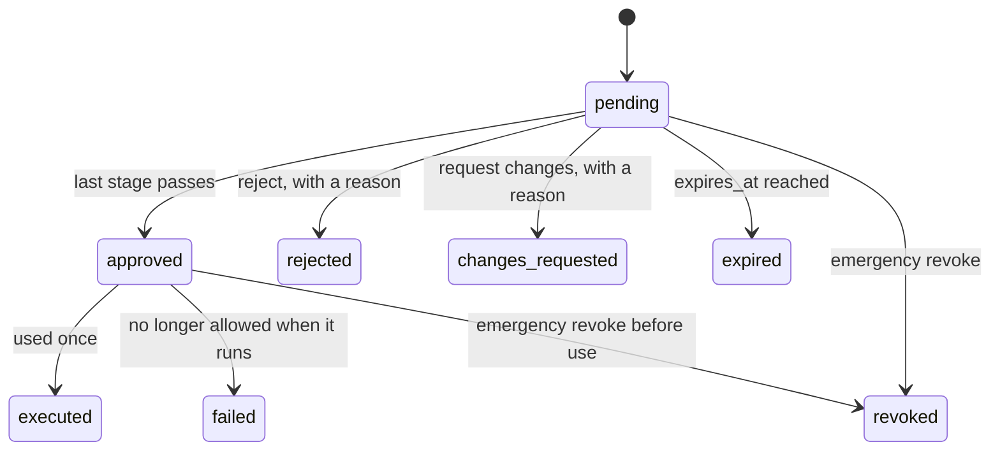

# Approvals

Some actions should not run until a person has looked at them: a 1800 EUR refund, a write
to the production ledger, an email from a run that just read a poisoned web page. An
approval in AgentGuard is bound to the exact action the person saw, used once, and
re-checked against policy at the moment the action runs
([ADR-0004](adr/0004-approvals-bound-to-the-action-hash.md)).

Code: `apps/api/src/agentguard/approvals/` (`service.py`, `models.py`, `router.py`), the
pipeline's approval step in `decisions/pipeline.py`, and the worker jobs in
`background.py`.

## Where requests come from

| Source | How |
| --- | --- |
| A policy rule with `decision: require_approval` | The pipeline creates the request with the deciding rule's approval requirement (the strictest one when several match) |
| OPA answering `require_approval` | One stage of security officers or org admins, 24 h |
| An agent unsure of itself | `POST /api/v1/approvals` with the action and a reason: the action is decided like `authorize`; a denied action stays denied, an allowed one becomes a pending request (`agent_asked`) |
| Without an explicit requirement | One stage, any reviewer, security officer or org admin, 24 h, the requester may not approve |

Approvals only hold actions in **enforce** mode. In audit mode the action is allowed and
recorded with `would_be: require_approval`.

## What a request holds

| Field | Purpose |
| --- | --- |
| `action_hash` | The canonical hash of organisation, agent, tool, action, resource and parameters. The approval approves this hash and nothing else |
| `params_sealed` | The exact parameters, sealed with the request id as context (KMS or the local key). Reviewers and above see them decrypted; auditors see `params_preview` |
| `params_preview` | The parameters with personal data and credentials redacted, for lists and auditors |
| `reason`, `policy_name`, `policy_version`, `risk_level` | Why it needs a person, from the deciding rule |
| `requirement` | `stages` (each `roles`, `users`, `count`), `expires_in_s`, `execute` (`agentguard` or `agent`), `forbid_requester` |
| `on_behalf_of` | The person the run acts for, as the calling application states it |
| `current_stage`, `status`, `decided_by`, `decision_comment` | Progress and outcome |
| `result` | When AgentGuard ran the action: the decision at execution, whether it ran, the redacted result (up to 50 KB) |

## Lifecycle

1. **Created** by the pipeline in the decision's transaction, with a `created` history
   entry, a notification job, an expiry job scheduled one second after `expires_at`, a
   live event and an `approval.requested` webhook.
2. **Notified**: the `approvals.notify` job emails every enabled user eligible for the
   current stage (minus the person the run acts for) with the agent, tool, action,
   resource, reason, risk, expiry and a link to the exact parameters, when the
   organisation's `notifications.approval_emails` is on. Subscribed webhooks get
   `approval.requested`. Each new stage is notified again.
3. **Voted**, stage by stage. Any reject or request for changes ends the request at once
   and needs a comment that the agent and its owner will see. A stage passes when `count`
   distinct eligible reviewers approved it.
4. **Approved** after the last stage. If `execute` is `agentguard`, the `approvals.execute`
   job is enqueued (deduplicated per request).
5. **Used once**, by the worker or by the agent, and recorded as `executed` with the
   decision that used it. If the re-check denies, the request becomes `failed` with the
   reason.

The agent learns the outcome by long-polling `GET /api/v1/approvals/{id}/status?wait=30`
(the SDKs' `wait_for_approval`), which returns the status, the reviewer's comment and, for
actions AgentGuard ran, the result.

## Who may vote

`service.eligible()` refuses a vote when:

- the request is not pending, or has expired (the vote expires it);
- the user is an auditor (`Auditors cannot decide approvals`);
- the user's role is not in the stage's `roles` and their email is not in its `users`;
- `forbid_requester` is on (the default) and the user's email equals the request's
  `on_behalf_of`: nobody approves an action taken on their own behalf
  (`test_nobody_approves_an_action_taken_on_their_own_behalf`);
- the user already voted on this stage (also a unique constraint on
  `(request_id, stage, user_id)`).

The two-person rule is `count: 2`: two distinct eligible people must approve the same
stage (`test_two_person_rule_needs_two_distinct_eligible_reviewers`). Votes are taken with
the request row locked, so two concurrent last votes cannot both pass the stage.

## Execution and re-authorization

The approval never short-circuits the decision. Execution goes back through the whole
pipeline at that moment, with the request's id as `approval_id`:

- **Tools AgentGuard runs** (`http`, `mcp`, `sandbox`, `execute: agentguard`): the worker
  opens the sealed parameters and calls `execute` as the agent. The pipeline re-checks
  agent status, the kill switch, the tool, the parameters, limits, risk and every policy.
  If the result is still `require_approval`, the approved request for this hash is
  consumed (`approved` to `executed`, one conditional `UPDATE`) and the action runs. If a
  policy now denies, the agent is suspended, or the kill switch is on, nothing runs and the
  request becomes `failed` (`test_policy_changed_after_approval_wins_at_execution`). While
  the worker runs it, the agent repeating the request is told to wait for the approval's
  result instead of racing it.
- **Function tools** (`execute: agent`): the agent repeats the same request (the SDK
  decorators do it after `wait_for_approval`). The pipeline finds the approved request for
  the same action hash, consumes it, returns `allow` with reason `approved`, and mints a
  decision token for the tool to verify.

If the agent names an approval for a different action (any parameter changed), the
answer is `deny` with `approval_mismatch`; a used approval gives `approval_used`; a
rejected one `approval_rejected` with the reviewer's comment; changes requested gives
`changes_requested`. An expired request is ignored and the next attempt creates a new
one.

One edge case: if a policy is relaxed between approval and execution so that the action is
now simply allowed, it runs on that allow and the approval is not consumed; the request
stays `approved` until it expires or is revoked.

## Expiry and emergency revoke

- Expiry: the scheduled `approvals.expire` job, plus the periodic `approvals.expire` task
  every 60 s as a safety net (a lost job, a clock jump), plus any vote attempted after
  `expires_at` (`test_expired_and_revoked_approvals_cannot_be_used`).
- `POST /api/v1/approvals/{id}/expire` ends a pending request now.
- `POST /api/v1/approvals/{id}/revoke` (security officer or org admin, reason required)
  stops a pending or approved-but-unused request. An executed one cannot be revoked; that
  is what incidents are for.

## History

Every event (`created`, `vote.approve`, `vote.reject`, `vote.request_changes`,
`stage.passed`, `approved`, `rejected`, `changes_requested`, `expired`, `revoked`,
`executed`, `failed`) is appended to `approval_history` with the actor and details. A
trigger refuses `UPDATE` and `DELETE` on that table
(`test_approval_history_cannot_be_changed`). Votes and decisions are also in the audit log
(`approval.approve`, `approval.reject`, `approval.revoked`, ...).

## API

| Endpoint | Who |
| --- | --- |
| `GET /api/v1/approvals` (pending first, filters by status) and `GET /api/v1/approvals/counts` | auditor and above |
| `GET /api/v1/approvals/{id}`: parameters (reviewer and above), votes, history, whether you may vote and why not | auditor and above |
| `POST /api/v1/approvals/{id}/approve`, `/reject`, `/request-changes` | reviewer and above, if eligible |
| `POST /api/v1/approvals/{id}/expire`, `/revoke` | security officer and above |
| `POST /api/v1/approvals` (ask a person) and `GET /api/v1/approvals/{id}/status` | the agent (its own requests only) |

Notifications: email to eligible reviewers, and the `approval.requested` and
`approval.decided` webhooks (`test_reviewers_are_notified_by_email_and_webhook`).
